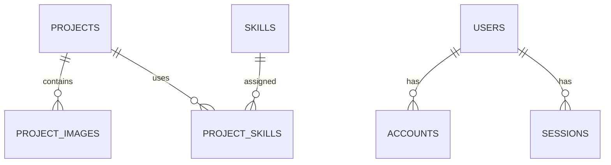

# Portfolio 3D

Ứng dụng Next.js App Router, TypeScript, Tailwind, React Three Fiber và Drizzle/PostgreSQL. Đây là bản foundation đang phát triển; CMS chưa đầy đủ và chưa sẵn sàng production.

## Chạy local

1. Cài Node.js và chạy `npm install`.
2. Sao chép `.env.example` thành `.env.local` và cấu hình các biến cần thiết. Không commit secret.
3. Tạo một database Neon riêng cho development/test. Chạy `npx drizzle-kit migrate` chỉ sau khi xác nhận `DATABASE_URL` trỏ tới database đó.
4. Chạy `npm run dev`. Google OAuth cần cấu hình redirect URI `/api/auth/callback/google`, `AUTH_SECRET` và `ADMIN_EMAILS` (danh sách email phân cách bằng dấu phẩy). Chỉ email Google đã xác minh và có trong allowlist được đăng nhập.

### Khi thấy “Portfolio chưa được thiết lập”

Ứng dụng chưa nhận được `DATABASE_URL`; đây là trạng thái cấu hình thiếu, không phải xác nhận database trống. Sao chép `.env.example` thành `.env.local`, điền `DATABASE_URL` bằng connection string PostgreSQL của Neon cho môi trường development/test, rồi dừng và chạy lại `npm run dev`. Không gửi connection string hoặc commit `.env.local`. Với Vercel, cấu hình biến server-side `DATABASE_URL` trong environment tương ứng và triển khai lại. `DATABASE_URL` không dùng tiền tố `NEXT_PUBLIC_`. Nếu đã cấu hình mà vẫn có lỗi, kiểm tra kết nối và migration trên database test; không tự áp dụng migration production.

Không tự chạy migration production. Trước migration quan trọng, tạo bản sao lưu bằng công cụ Neon hoặc `pg_dump` tới nơi an toàn; kiểm tra phục hồi với `pg_restore` trên database riêng. Xem SQL trong `drizzle/` trước khi áp dụng.

## Mô hình dữ liệu

Profiles, experiences, education, media assets, site settings và contact messages là các bảng độc lập. Dữ liệu nhị phân không lưu trong database. Migration ban đầu: `drizzle/0000_marvelous_patriot.sql`.

## Tình trạng

Trang public chỉ truy vấn dự án published. `/admin` có đăng nhập Google và tạo/xóa dự án cơ bản; các chức năng CMS còn lại, contact form, kiểm thử database và các kiểm tra bảo mật/performance cần hoàn thành trước khi triển khai. Bảng Auth.js đã được tạo, hiện xác thực dùng phiên JWT và chưa kết nối Drizzle Adapter. Chưa có seed hoặc dữ liệu thật.
